<p align="center">
  
</p>

<h1 align="center">Plex Poster Set Helper 2</h1>

<p align="center">
  Find community poster art on <b>MediUX</b> and <b>ThePosterDB</b> and apply it to your Plex library in one click.<br />
  A desktop app for Windows and Linux, or a web app in Docker for always-on servers.
</p>

<p align="center">
  <a href="https://molexxxx.github.io/plex-poster-set-helper-2/"></a>&nbsp;
  <a href="https://github.com/molexxxx/plex-poster-set-helper-2/releases/latest"></a>&nbsp;
  <a href="https://github.com/molexxxx/plex-poster-set-helper-2/releases"></a>&nbsp;
  <a href="https://github.com/molexxxx/plex-poster-set-helper-2/actions/workflows/ci.yml"></a>&nbsp;
  <a href="docker/README.md"></a>&nbsp;
  <a href="LICENSE"></a>
</p>

<p align="center">
  <a href="https://molexxxx.github.io/plex-poster-set-helper-2/docs/">Docs</a> &nbsp;·&nbsp; <a href="https://molexxxx.github.io/plex-poster-set-helper-2/changelog/">Changelog</a>
</p>

## What it does

Pick a movie, show, or collection from your Plex library, browse every poster set the MediUX and ThePosterDB communities have made for it, and apply one with a click. Posters, season posters, episode title cards, backdrops, and collection art each land on the right item, and a schedule can keep them current as new episodes and uploads arrive.

<p align="center">
  
  
  
  
  
  
</p>

## Install

You need a Plex Media Server and a Plex account that can manage it.

| You want to | Use |
|---|---|
| Use it on your Windows or Linux PC | [Desktop app](#desktop-app) |
| Keep schedules running 24/7 on a server or NAS, from any browser | [Docker](#docker) |
| Run it on Unraid | [Unraid](#unraid) |
| Use it on a Mac | [Docker](#docker), since there is no macOS desktop build |

### Desktop app

1. Download the installer for your system from the **[latest release](https://github.com/molexxxx/plex-poster-set-helper-2/releases/latest)**. Both are 64-bit (x64) builds.
   - **Windows:** the `.exe` installer
   - **Linux:** the `.AppImage` or the `.deb`
2. Install and launch it, then follow [First run](#first-run).

The app checks GitHub for new versions and updates itself with one click.

### Docker

The Docker build runs the full app as a web page, and its schedules keep firing for as long as the container is up.

```bash
git clone https://github.com/molexxxx/plex-poster-set-helper-2.git
cd plex-poster-set-helper-2
./docker/run.sh
```

On Windows, run `./docker/run.ps1` in PowerShell for the last step. Then open `http://localhost:3939` and sign in with Plex.

The script builds the image from your checkout and keeps your settings in a Docker volume. A prebuilt image, [`tonywied17/plex-poster-helper-2`](https://hub.docker.com/r/tonywied17/plex-poster-helper-2), is also published with every release. The **[Docker guide](docker/README.md)** walks through each step and covers Compose and everyday commands.

### Unraid

Install it from **Community Applications**: search for _Plex Poster Helper_ in the **Apps** tab ([listing](https://ca.unraid.net/apps/plex-poster-helper-2-1qbjs0q1mmwhy6)). It pulls the prebuilt image and adds a **WebUI** button, so no commands are needed.

## First run

1. **Browser check.** The app ships with the Chromium headless shell it uses to read the poster sites, so the first launch only checks that it starts. Nothing is downloaded. If the check fails, see [Troubleshooting](#troubleshooting-and-support).
2. **Sign in to Plex.** Open **Settings → Plex Account → Sign in with Plex** and approve the request in your browser; the Docker web page asks you to sign in as soon as it opens. Your server is detected automatically and every library is included. To leave one out, uncheck it under **Settings → Libraries**.
3. **Add a TMDB API key** (optional, recommended). A free [TMDB API key](https://www.themoviedb.org/settings/api) fixes most matching problems for titles Plex stores without a TMDB ID. The first launch offers a step to paste one, or add it later under **Settings → TMDB Matching**. See [How matching works](#how-matching-works).

That's it: open the **Library Browser** and start applying posters.

## Library Browser

Pick a title and its MediUX and ThePosterDB sets appear in one list, each tagged with its site, with chips to show just one. Sets are listed most downloaded first: MediUX by its download counts, which each card shows, and ThePosterDB in the site's own downloads order, with the two sites alternating rank by rank when both are shown.

- **Follow or hide creators** with the star and eye on any set card. Followed creators come first and hidden ones drop out of every list. The **Creators** tab manages both lists and browses a MediUX creator's whole catalog.
- **Find what still needs attention.** The art filter narrows the grid to titles with or without applied art, art that no job keeps updated, or art from a particular creator. On TV tabs, a status filter separates **Continuing** series from **Ended** ones, using TMDB when a key is set and otherwise whether an episode aired in the last year.
- **Collections** have their own tab, with collection art from both sites.
- **Ctrl+F** opens the command palette to jump to any page, setting, schedule, or creator, or to paste a link.

## Keeping posters up to date

The **Scheduler** re-applies sets and creators on a repeating schedule, so new episode title cards and new uploads get art without a trip back to the app.

- **Quick sync:** click **Schedule** on any set or **Sync all** on a MediUX creator. Repeat clicks never stack duplicate jobs, a creator's sets share one job, and **Scheduler → Quick sync** picks the schedule these buttons use.
- **Whole MediUX catalogs:** a creator job reads every set the creator has published. The first run crawls the catalog once, which takes a few minutes for a prolific creator; later runs only read pages with new or updated sets.
- **Only apply new artwork** (on by default) skips posters already applied to an item, so Plex doesn't pile up duplicates. **Only fill gaps** makes a job a backup creator that adds only what other art doesn't cover.
- **One at a time, in order:** jobs never overlap. Jobs due together run in the order shown on the Scheduler page, which you set with the arrows on each card, and **Run now** goes ahead of anything waiting. When two creators cover the same show, put your preferred one first and give the other **Only fill gaps**.
- **Any schedule:** hourly, daily, weekly on chosen days, monthly, or a custom cron expression, with a preview of the next runs. Each job keeps its 10 most recent runs; click one to see which titles got art, which failed, and which aren't in your library.
- **Where it runs:** the desktop app runs schedules while it's open or minimized to the tray, and **Launch at login** on the Scheduler page starts it with your computer. For schedules that run around the clock without a PC left on, use [Docker](#docker).

## Updating

Your Plex sign-in, schedules, and applied-poster history survive every update. The desktop app keeps them in your user profile, and Docker keeps them in its config volume.

- **Desktop app:** accept the in-app update, or download the latest installer from [Releases](https://github.com/molexxxx/plex-poster-set-helper-2/releases/latest).
- **Docker:** pull the new code and rebuild. On Windows, run `./docker/run.ps1 -Build` for the last step.

  ```bash
  git pull
  ./docker/run.sh --build
  ```

  Compose steps are in the [Docker guide](docker/README.md#updating-to-a-new-version).
- **Unraid:** in the **Docker** tab, open the container and choose **Force update**.

## Troubleshooting and support

- **The first-launch browser check fails.** The setup screen explains why and offers fixes. On Linux it shows the exact command for any missing system libraries, and on any platform you can pick an installed Google Chrome, Edge, Brave, or Chromium instead. **Settings → Browser Engine** also has a managed download that retries automatically, detects system proxies, and can be canceled.
- **A title gets no match or the wrong art.** Add a TMDB API key (see [How matching works](#how-matching-works)), and use **Title Mappings** to point a site's title at the right Plex title.
- **Anything else.** The log drawer shows what the app is doing, and **Open Log Folder** in the command palette opens the full logs. If you're stuck, [open an issue](https://github.com/molexxxx/plex-poster-set-helper-2/issues) with the relevant log lines.

## Supported links

**Manual Import** and scheduled jobs accept links from both sites.

| Site | Links |
|---|---|
| **[MediUX](https://mediux.pro)** | Sets (`/sets/123`), boxsets (`/boxsets/123`, a whole collection at once), show pages (`/shows/123`), and creator pages (`/user/name`). Full-quality posters, season posters, title cards, and backdrops. |
| **[ThePosterDB](https://theposterdb.com)** | Sets (`/set/123`), single posters (`/poster/123`), and user uploads (`/user/name`). |

## How matching works

Posters are matched to your library by **TMDB ID**, read from each Plex item, so the right art lands on the right title. For titles Plex stores without a TMDB ID, or under a TVDB or IMDb agent, a free TMDB API key restores ID-based matching; without one the app falls back to title and year, which can miss renamed or subtitled entries. Anime under the **HAMA** agent, which tags titles with an AniDB ID, is converted to TMDB automatically using the open-source [Fribb/anime-lists](https://github.com/Fribb/anime-lists) dataset (cached locally), so it matches without a key. ThePosterDB has no public ID search, so its sets are always found by title and year.

Everything you apply is recorded locally, so the **Reset Posters** page knows what's current, what was applied before, and where it came from, and can restore Plex's original artwork.

## Screenshots

<details>
<summary>Show screenshots</summary>
<br />
<table>
  <tr>
    <td width="50%"><a href=".github/assets/gallery/library-browser.png">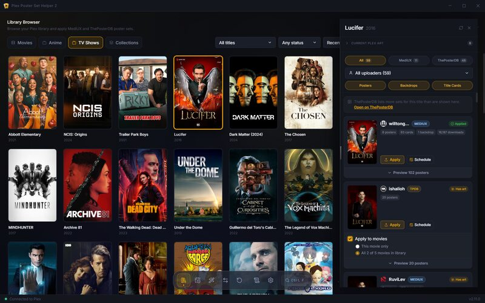</a><br /><sub>Library Browser</sub></td>
    <td width="50%"><a href=".github/assets/gallery/1-creators-browser.jpg">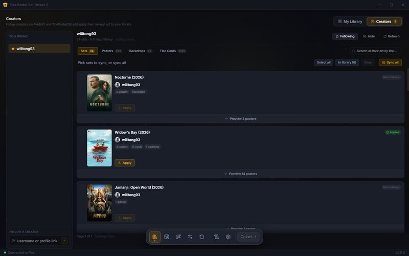</a><br /><sub>Creators tab</sub></td>
  </tr>
  <tr>
    <td><a href=".github/assets/gallery/1.05-collection-browser.jpg">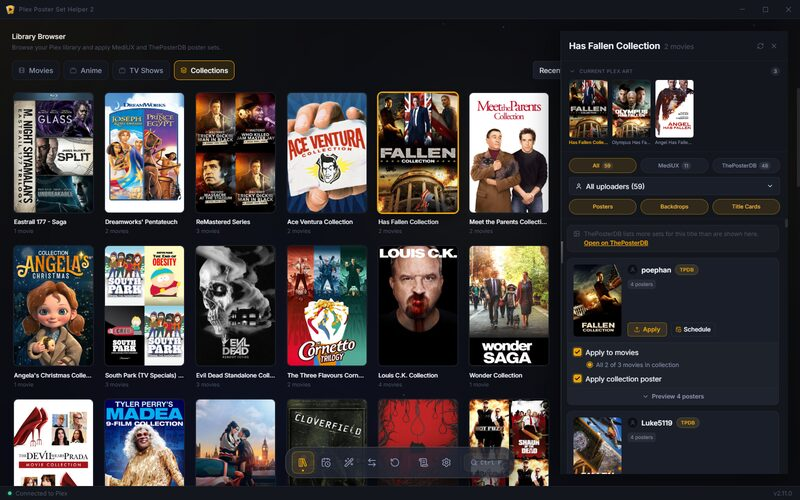</a><br /><sub>Collections tab</sub></td>
    <td><a href=".github/assets/gallery/1.1-search-1.jpg">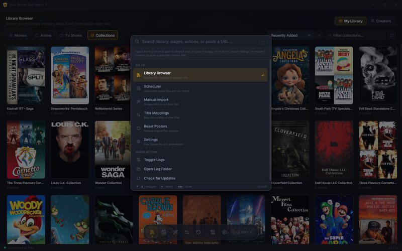</a><br /><sub>Command palette</sub></td>
  </tr>
  <tr>
    <td><a href=".github/assets/gallery/1.2-search-2.jpg">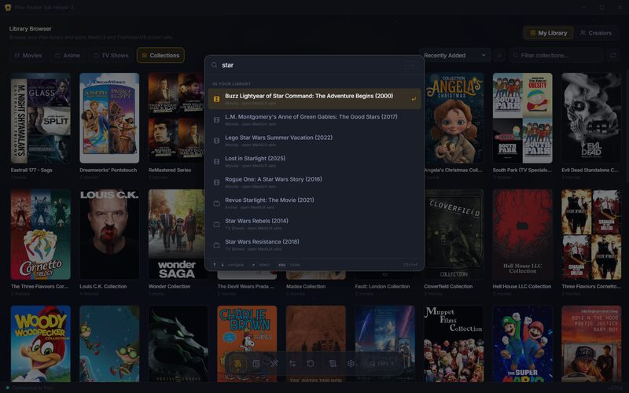</a><br /><sub>Library search</sub></td>
    <td><a href=".github/assets/gallery/2-scheduler-list.jpg">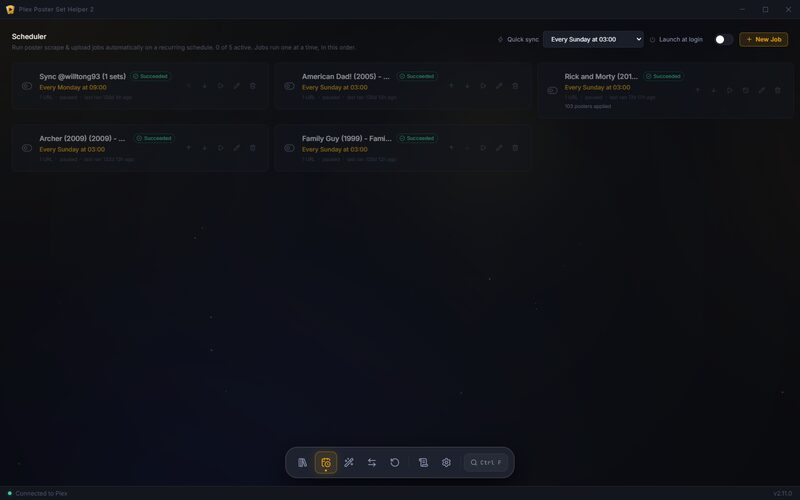</a><br /><sub>Scheduler</sub></td>
  </tr>
  <tr>
    <td><a href=".github/assets/gallery/3-scheduler-edit.jpg">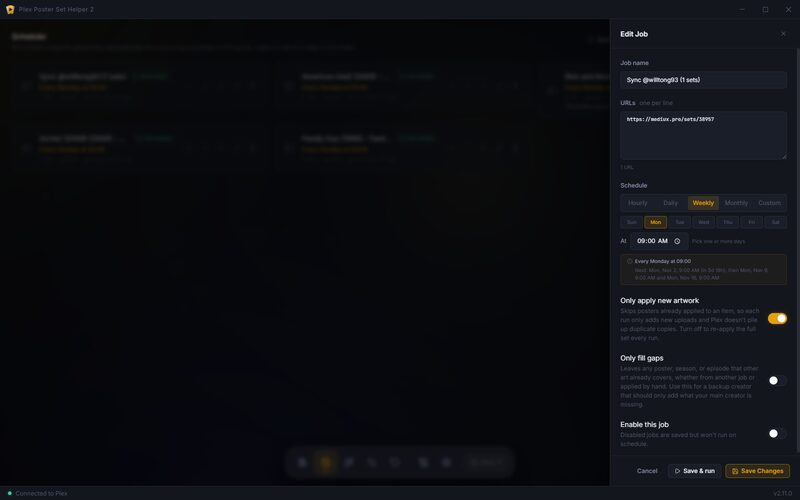</a><br /><sub>Job editor</sub></td>
    <td><a href=".github/assets/gallery/4-title-mappings.jpg">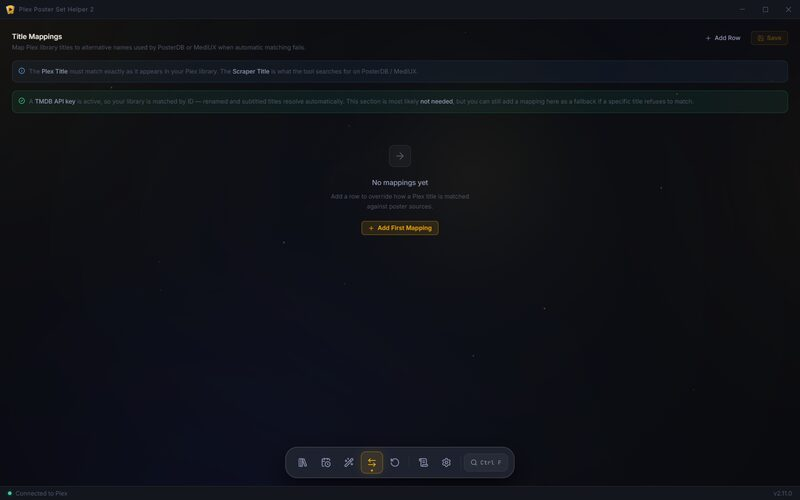</a><br /><sub>Title Mappings</sub></td>
  </tr>
  <tr>
    <td><a href=".github/assets/gallery/5-manual-scrape-top.jpg">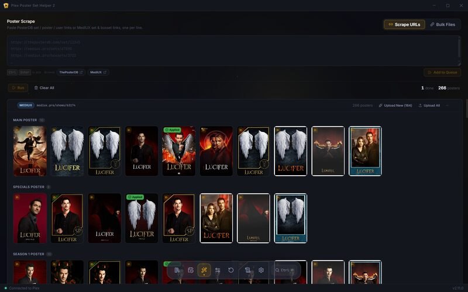</a><br /><sub>Manual Import</sub></td>
    <td><a href=".github/assets/gallery/6-manual-scrape-titles.jpg">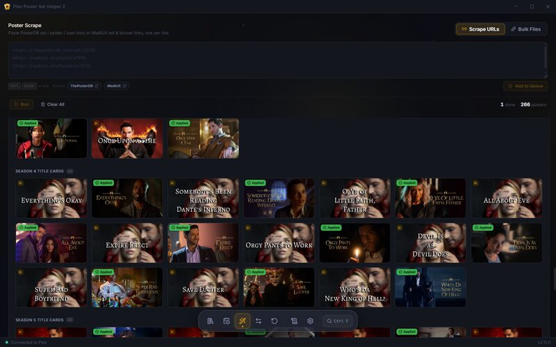</a><br /><sub>Manual Import, applied art marked</sub></td>
  </tr>
  <tr>
    <td><a href=".github/assets/gallery/7-reset-posters.jpg">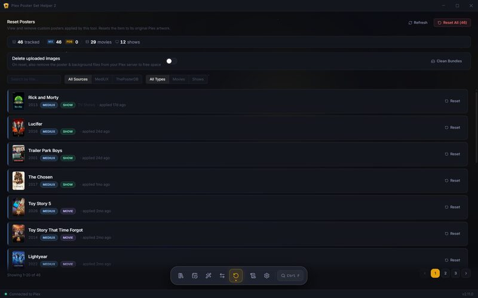</a><br /><sub>Reset Posters</sub></td>
    <td><a href=".github/assets/gallery/10-log-drawer.jpg">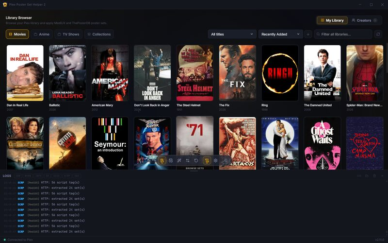</a><br /><sub>Log drawer</sub></td>
  </tr>
  <tr>
    <td><a href=".github/assets/gallery/8-settings-top.jpg">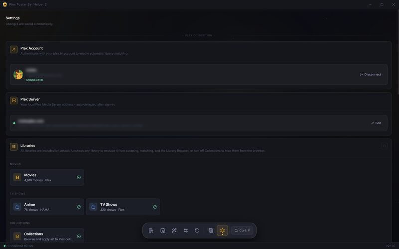</a><br /><sub>Settings</sub></td>
    <td><a href=".github/assets/gallery/9-settings-bottom.jpg">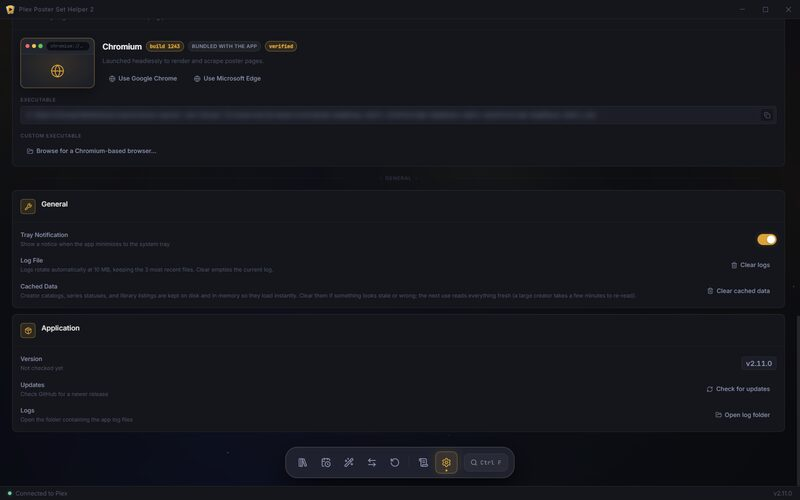</a><br /><sub>Settings, continued</sub></td>
  </tr>
</table>
</details>

## Development

Running from source needs an LTS release of **Node.js, 22.13 or newer**.

```bash
git clone https://github.com/molexxxx/plex-poster-set-helper-2.git
cd plex-poster-set-helper-2
npm install
npm run dev
```

| Command | What it does |
|---|---|
| `npm run dev` | Runs the app with hot reload |
| `npm test` | Runs the unit tests (Vitest) |
| `npm run lint` | Lints with ESLint |
| `npm run typecheck` | Type-checks the renderer, main process, and web server |
| `npm run build` | Builds the renderer and main process |
| `npm run dist:win` | Packages the Windows installer |
| `npm run dist:linux` | Packages the Linux AppImage and deb |

To update a source checkout, run `git pull` and `npm install`, then `npm run dev`.

**Stack:** Electron, React 19, TypeScript, Vite, Tailwind, Playwright for scraping, and Fastify for the web and Docker server.

## Contributing

Issues and pull requests are welcome. Before opening a PR, run `npm run lint`, `npm run typecheck`, and `npm test`; CI runs all three and builds the app.

## License and credits

[MIT](LICENSE) © molexxxx

- **[MediUX](https://mediux.pro)** and **[ThePosterDB](https://theposterdb.com)**, the communities behind the artwork.
- Inspired by [bbrown430/plex-poster-set-helper](https://github.com/bbrown430/plex-poster-set-helper), the original Python tool, and rebuilt from the ground up as a cross-platform app.
